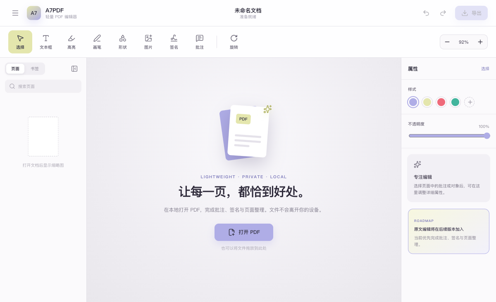

# A7PDF

一款漂亮、轻量、默认离线的跨平台 PDF 编辑器。

> 项目处于早期开发阶段。当前优先实现查看、页面整理与导出；直接修改 PDF 原有文字将在后续版本加入。



## 技术栈

- [Tauri 2](https://tauri.app/)：轻量的 Windows / macOS 桌面外壳
- React + TypeScript：界面与编辑交互
- PDF.js：初期 PDF 渲染层
- MuPDF：计划中的核心编辑引擎

## 当前能力

- 打开本地 PDF
- 高质量页面渲染
- 连续滚动、页面缩略图、缩放和旋转
- 按页或按整份 PDF 编排、合并与导出
- 导入图片作为 PDF 页面，并调整图片的位置和尺寸
- 框选当前 PDF 页面的可见区域，复制并粘贴到同一页，随编排结果导出
- 撤销与重做页面编排及粘贴操作
- 本地优先的三栏编辑器界面

框选复制会将选区保存为图像贴片，不会修改原 PDF 的图片对象；目前仅支持粘贴到来源页。

## 路线图

- [ ] 批注对象模型与撤销/重做
- [ ] 高亮、手绘、形状与文本框
- [ ] 图片、图章等对象的进一步编辑
- [ ] 页面拆分
- [x] 页面旋转、排序、删除与合并
- [x] PDF 导出
- [ ] MuPDF 引擎集成
- [ ] 表单填写与脱敏
- [ ] 原有文字和图片对象编辑
- [ ] Windows 与 macOS 自动构建

## 本地开发

需要 Node.js、npm、Rust，以及对应平台的 Tauri 2 系统依赖。

```bash
npm install
npm run tauri dev
```

只运行前端界面：

```bash
npm run dev
```

## 构建

```bash
npm run build
npm run tauri build
```

## 开源许可

本项目使用 [GNU Affero General Public License v3.0 or later](LICENSE)。

MuPDF 集成后，本项目会继续遵守其 AGPL 许可要求，并在应用内提供显著的源码与第三方许可入口。
